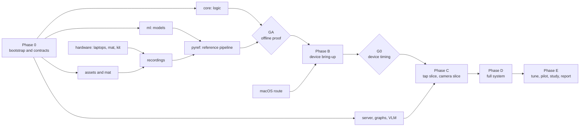

# ANCHOR build plan

This file says what to build, in what order, who can do it, and what each piece of work must leave behind. It holds 100 tasks in 15 lanes, sized at 666 human hours.

- Design authority: the Deliverable II report in `docs/report/`. If this plan and the report disagree, stop and raise it.
- Working rules for anyone (human or AI agent) who touches the repo: `AGENTS.md`.
- This file changes rarely. Live status is in GitHub Issues (one per task) and in `notes/`. Nobody edits this file to mark progress.

Last planned: 2026-11-11.

## 1. Where we are

| Exists | State |
| --- | --- |
| Deliverable II report | Complete design: capabilities, requirements, procedure graph, gate, sequencer, recovery, trigger policy, architecture |
| Concept demo | Click-through HTML over support footage. No perception |
| Screw detectors | YOLO26n AP50 0.734 on the WEEE test at 1280 px. No laptop screws, no screw-state reader |
| Component detectors | 0.86 to 0.90 AP50 on the one training laptop, about 0.1 on unseen laptops |
| Segmenter | MobileSAM chosen for outlines |
| Everything else | Not started: tools, hands, contacts, registration, tracking, the app, the server, graphs |

### Architecture in brief

- **App, on the iPhone.** Tier A runs every frame: ARKit pose and depth, mat pose, change check, hand mask, drawing. Tier B runs on changed frames: slot-crop classifiers, the tool model, contacts, the gate. Then the sequencer, the trigger policy and the widgets.
- **Server, on the GPU PC.** Graph builder and stores, MobileSAM outlines, the VLM proxy, optional part localisation. This is tier C: events only.
- **Hosted VLM.** One narrow question per exception.
- An expected step never leaves the device.

## 2. Decisions and constraints

### 2.1 Decisions

| # | Decision | Status on 2026-11-11 | What it blocks |
| --- | --- | --- | --- |
| D1 | The three study laptops | Open. Team will name them | Every task tagged LAPTOPS; `HW-02` |
| D2 | LiDAR device | iPhone 13 Pro | Nothing; it meets NFR-08 |
| D3 | macOS access | Open. No Mac today; see 2.2 | Every task tagged MAC, which is 153 of 666 hours |
| D4 | Movement widgets in 3D | Yes, in scope | - |
| D5 | Mat and anchoring | Decided here: printed marker mat, 6-DoF mat pose, the report's two homographies as fallback; see 2.4 | - |
| D6 | VLM providers | Chosen by measured cost and accuracy in `VLM-02` | In-session VLM calls, graph building |
| D7 | Server | The team's RTX 4070 Super PC behind a private tunnel; see 2.3 | - |
| D8 | FYP-II calendar | Starts early 2027. Phases 0 and A run before it | - |
| D9 | May the study use hand-reviewed graphs | Decide after `GR-06` | Study design |
| D10 | VLM calls go through the server, so API keys never ship in the app | Proposed here; confirm in `BOOT-03` | `VLM-01`, `IOS-12` |

Laptop criteria for D1: not Apple; two from one maker and one from another; available for the whole project with a spare bottom cover; a public service manual for the exact model number; an internal battery with a connector; between them a memory slot, an M.2 or 2.5-inch drive, and at least one screw hidden under a foot or label.

### 2.2 No Mac: what works

An iOS app can only be compiled and signed by Xcode on macOS. There is no way around that, but there are several ways to get macOS, and most of this project does not need it.

| Route | What it gives | Limits | Verdict |
| --- | --- | --- | --- |
| A used Apple-silicon Mac mini, or regular access to a lab Mac | Xcode, a debugger on the phone, Instruments, installs with a free Apple account (each lasts 7 days) | Cost or access | Best. Aim to have it when Phase B starts |
| GitHub Actions macOS runners plus TestFlight | Builds, signs and delivers the app with no Mac | Needs the paid Apple Developer Program. No debugger, no Instruments. Every change costs a CI build | Works. The planned fallback |
| Rented cloud Mac over remote desktop | The Xcode interface for signing setup and Reality Composer Pro | The phone cannot be plugged in, so installs still go through TestFlight | Occasional setup only |
| Unofficial Windows sideloading with a free Apple account | Installs a CI-built app without the paid programme | Unofficial, fragile, 7-day expiry | Stopgap |
| macOS on non-Apple hardware | - | Against Apple's licence terms; unreliable with Xcode | Do not use |
| Switch to Android and ARCore | Builds on Windows and Linux | Contradicts NFR-08 and the LiDAR contact check; a redesign | Last resort |

CI cost on GitHub's current price list: standard runners are free for public repositories. For a private repository on the free plan, macOS minutes cost about ten times Linux minutes, and the free monthly allowance covers roughly 190 macOS minutes at the rates listed on 2026-11-11. Check GitHub's billing page before relying on it.

What needs no Mac at all: every Python package, `core/` (the Swift toolchain runs on Linux, WSL2 and Windows), assets (Blender), recordings (the Stray Scanner app writes RGB video, LiDAR depth, camera poses and intrinsics), Core ML export (Ultralytics supports it on macOS or x86 Linux, so use WSL2 or CI on a Windows PC), and checking USDZ assets (AR Quick Look on the phone).

The plan is built around this:

1. All guidance logic lives in `core/`, pure Swift, built and tested on Linux.
2. Every perception and registration algorithm is first written in `pyref/` and proven on recordings. The iOS code is a port with parity tests against it.
3. The Xcode project is generated from `ios/project.yml`, so project structure is edited as text.
4. A benchmark screen, a debug overlay and exportable logs replace the debugger.

Result: 513 of 666 hours carry no MAC tag. D3 must be settled by the time Phase A ends, not before.

### 2.3 The server

The RTX 4070 Super PC is enough. The server's work is light: MobileSAM for outlines, the graph builder (which mostly calls the hosted VLM), two small stores, the VLM proxy, and optionally one localisation model.

- Software: Linux or WSL2, NVIDIA drivers, Python, FastAPI. No public IP and no router port forwarding.
- Exposure: Tailscale on the PC and on the iPhone. The phone reaches the PC from any network, nothing is open to the internet, and Tailscale provides the HTTPS certificate iOS expects. The free personal plan is enough. If an examiner's device must reach it without Tailscale, add Cloudflare Tunnel then.
- Keep an API key on every route regardless.
- Operations: the PC must be on and awake during sessions. Never train while a bench or study session is using the server; training already ran this PC out of memory twice.
- If the server is unreachable, the app keeps working as the report specifies: cached graphs, boxes instead of outlines, hazard banners that stay up.

### 2.4 The mat

The mat is a printed sheet that the laptop sits on, with square black-and-white markers at known positions. From any frame that shows a few markers, the app knows where the mat is in 3D and how large a millimetre is. That is what keeps widgets locked to screws while hands cover the laptop.

- `AS-01` generates the print file. Nothing to design by hand.
- A2 sheet, matte. A laptop outline in the centre, a ring of markers just outside it, and four corner markers.
- Print at 100% scale and check the printed 100 mm bar (`HW-03`). For early tests, print the tiled A4 version and tape it to a board.

## 3. How the work is organised

Work is split into lanes. A lane owns folders, and only tasks in that lane change those folders. Lanes meet at the contracts in Section 5 and nowhere else. That is what lets several people and agents work at once.

| Lane | What it builds | Paths it owns | Human owner | Hours |
| --- | --- | --- | --- | --- |
| BOOT | Bootstrap | repo root, `contracts/`, `scripts/`, `.github/` | all three | 19 |
| HW | Hardware and accounts | `docs/hardware.md`, `docs/vlm-costs.md` | H-APP | 15 |
| CORE | Guidance logic (Swift, builds on Linux) | `core/` | H-SYS | 63 |
| ML | Models and datasets (Python) | `ml/` | H-ML | 83 |
| REF | Reference pipeline on recordings (Python) | `pyref/` | H-ML | 40 |
| SRV | Server | `server/` except the two folders below | H-SYS | 20 |
| GR | Procedure graphs | `server/graph_builder/`, `graphs/`, `resources/` | H-SYS | 47 |
| VLM | VLM adapter | `server/vlm/` | H-SYS | 17 |
| AS | Assets and mat | `assets/`, `tools/mat/`, `tools/blender/` | H-APP | 16 |
| DATA | Recordings and labels | `docs/recording/`, `data-manifests/` (raw data stays out of git) | H-ML | 70 |
| EV | Evaluation | `eval/`, `results/` | H-SYS | 28 |
| IOS | iOS app | `ios/` | H-APP | 123 |
| INT | Integration | no code of its own; fixes go to the owning lane | H-APP | 22 |
| ST | User study | `docs/study/` | all three | 58 |
| DOC | Reports | `docs/deliverables/` | all three | 45 |
| | **Total** | | | **666** |

Three human roles, to be assigned to names: **H-SYS** (logic, server, graphs, evaluation), **H-ML** (models, data, reference pipeline), **H-APP** (iOS, assets, hardware). Each owner reviews and merges the work in their lanes.

**Who** column:

- **Agent**: an AI coding agent does the work end to end; the lane's human owner reviews and merges. 57 tasks, 337 hours of human time for specifying, reviewing and checking.
- **Pair**: a human at the keyboard or bench with an agent. 156 hours.
- **Human**: cannot be delegated: buying, printing, recording, auditing labels, the study. 173 hours.

**Needs** column, the hardware and access tags:

| Tag | Meaning |
| --- | --- |
| MAC | A working macOS build route (D3) |
| PHONE | The iPhone 13 Pro in hand |
| LAPTOPS | The study laptops in hand (D1) |
| KIT | The tool kit in hand |
| MAT | The printed mat |
| GPU | The 4070 Super PC, one job at a time |
| KEYS | VLM API keys on the server |
| PEOPLE | Study participants |

An agent may write code for a tagged task, but only a human with the hardware can close it.

Review is the bottleneck, not writing. Each human keeps at most three agent pull requests open for review at a time.

## 4. Repository layout

```
anchor/
  PLAN.md  AGENTS.md  Makefile
  contracts/        C1 to C10: schemas, OpenAPI file, fixtures
  core/             AnchorCore Swift package (no Apple-only imports)
  ml/               datasets, training, evaluation, export
  pyref/            Python reference pipeline that runs on recordings
  server/           FastAPI app; graph_builder/ and vlm/ are separate lanes
  graphs/           built and reference procedure graphs
  resources/        index of manuals and guides (files stay out of git)
  assets/           USDZ and GLB models, manifest
  tools/            mat/ and blender/ generators
  ios/              project.yml, AnchorApp, AnchorAR, AnchorPerception
  eval/             metrics, tuning, ablations
  results/          metric files stamped with configuration and data hashes
  config/           anchor.default.json: every tunable value
  data-manifests/   file lists and hashes of datasets and recordings
  notes/            one hand-off note per finished task
  docs/             report/, decisions/, recording/, study/, deliverables/,
                    hardware.md, measurements.md, report-deltas.md, risks.md
  scripts/          repo tooling
```

Datasets, recordings, model weights and API keys never enter git.

## 5. Contracts

`BOOT-03` writes these first. After that, a contract changes only through a pull request that touches `contracts/` alone, bumps its version, and is approved by every lane owner who uses it.

| # | Contract | File | Used by |
| --- | --- | --- | --- |
| C1 | Procedure graph: schema from report Section 4.9, plus the structured motion field | `contracts/graph.schema.json` | CORE, GR, IOS |
| C2 | Observations: fact readings with scores and hidden share, contacts, registration trust, timestamps | `contracts/observations.schema.json` | REF, CORE, IOS, EV |
| C3 | Configuration: every setting in report Table 6.3, with provisional values | `config/anchor.default.json` and its schema | all |
| C4 | Recording: a clip folder with RGB, depth, poses, intrinsics, events, metadata. Stray Scanner clips convert into it | `contracts/recording.md` | DATA, REF, IOS, ML |
| C5 | Server API | `contracts/server.openapi.yaml` | SRV, GR, VLM, IOS |
| C6 | Session log: one JSON line per event | `contracts/log.schema.json` | CORE, EV, IOS |
| C7 | Model card: name, input size, classes, output decoding, export settings | `contracts/model-card.schema.json` | ML, REF, IOS |
| C8 | Asset manifest: tool names, files, tip offset, allowed motions | `contracts/asset-manifest.schema.json` | AS, GR, IOS |
| C9 | Class sheet: component, tool and screw-state classes with one definition each | `contracts/classes.yaml` | ML, DATA, REF |
| C10 | Widget commands: what the trigger policy hands the renderer | `contracts/widget-commands.schema.json` | CORE, IOS |

## 6. Where to start

1. **Today, humans, all at once.** Start `HW-01` (laptops), `HW-04` (macOS route), `HW-05` (server PC), `HW-06` (VLM keys), `HW-07` (Stray Scanner test clip), `HW-08` (phone mount). None depends on anything.
2. **Today, one human with an agent.** `BOOT-01`, the repository skeleton.
3. **Next, in parallel.** Agents take `BOOT-02`, `BOOT-04` and `AS-01`. One human pairs on `BOOT-03`, the contracts. All three humans review it. Nothing in Phase A starts before it merges.
4. **The first wave.** When `BOOT-03` merges, nine tasks open at once: `CORE-01`, `CORE-03`, `CORE-11`, `ML-01`, `SRV-01`, `AS-02`, `AS-03`, `EV-01`, `DATA-01`. They sit in different lanes, or in separate modules of one lane. `REF-01` joins them as soon as the `HW-07` test clip exists.
5. **Then follow each lane downward.** Section 8 lists every lane in order; Section 9 shows what can run together.
6. **When the mat is printed and laptop 1 is in hand.** Record `DATA-02`. That unlocks registration (`REF-03`), enrolment (`ML-07`) and the first end-to-end replay (`REF-05`).
7. **Gate GA** closes Phase A. Only then is on-device work worth starting.



## 7. Phases and gates

| Phase | Content | Hours | Tasks |
| --- | --- | --- | --- |
| 0 | Bootstrap, hardware and accounts | 36 | 13 |
| A | Everything that needs no Apple build tools | 280 | 51 |
| B | Device bring-up | 53 | 7 |
| C | Slices | 47 | 6 |
| D | Full system | 132 | 14 |
| E | Tune, study, report | 118 | 9 |

Phases 0 and A run before FYP-II. Phases B to E map onto its sixteen weeks: B in weeks 1 to 2, C in weeks 3 to 6, D in weeks 7 to 10, E in weeks 11 to 16. If the macOS route is ready early, start Phase B early.

| Gate | Closes | Passes when | If it fails |
| --- | --- | --- | --- |
| GA | Phase A | `REF-05`: on laptop 1's two clean-run clips, the offline pipeline recognises at least 90% of steps | Fix perception in `pyref/` first. Do not port a pipeline that does not work offline |
| G0 | Start of Phase B | `IOS-05`: all tier B models together take at most 150 ms per processed frame on the iPhone 13 Pro | Fewer crops per batch, smaller tool model, lower processing rate |
| G1 | Phase C, first half | `IOS-11`: a person completes laptop 1's storage task guided by taps; rings within 5 mm of the screws | Fix registration and rendering before adding the camera |
| G2 | Phase C | `IOS-13`: the same task driven by the camera meets NFR-02 (next step within 2 s, 95th percentile) on the bench; `ML-07` at 0.85 AP50 or better | Hold scope at one laptop and one task until it passes |
| G3 | Phase D | `INT-01`: three laptops by three tasks run on the bench with all six widgets | Cut optional items first: `GR-07`, `SRV-05`, FR-17 |
| G4 | Before the main study | `INT-02` configuration frozen; `EV-05` reports every NFR on the test split; the `ST-02` pilot shows novices make mistakes with the manual alone | Choose a harder task or laptop (report risk R-04) |

## 8. Tasks

Columns: **Who** and **Needs** as in Section 3. **After** lists the tasks that must be merged first. **h** is human hours. **Done when** is the acceptance test. **Record** is what the hand-off note must contain beyond the standard template.

Acceptance numbers are this plan's proposals, not report requirements, except where a requirement ID is quoted.

### BOOT: Bootstrap

Paths: repo root, `contracts/`, `scripts/`, `.github/`. Human owner: all three. Lane total: 19 h.

| ID | Task | Who | Needs | After | h | Done when | Record |
| --- | --- | --- | --- | --- | --- | --- | --- |
| `BOOT-01` | Repository skeleton: folders from Section 4, ignore rules, PR template, `notes/`, `docs/decisions/`, this file, AGENTS.md, the report PDF under `docs/report/` | Pair | - | - | 3 | Skeleton on `main`; branch protection on; a pointer file for any tool that expects a different name than AGENTS.md | ADR-001: repository visibility and licence |
| `BOOT-02` | Makefile and Linux CI: `make setup`, `test-core`, `test-ml`, `test-server`, `lint` | Agent | - | BOOT-01 | 3 | CI is green on placeholder tests for the Swift package and both Python packages | Pinned tool versions |
| `BOOT-03` | Contracts v0 (C1 to C10, Section 5) with fixtures | Pair | - | BOOT-01 | 12 | Every schema validates its fixtures in CI; all three humans approve the PR | One ADR per non-obvious choice; a list of open questions |
| `BOOT-04` | `scripts/sync_issues.py`: one GitHub issue per task in this file, labelled by lane, phase and hardware tags | Agent | - | BOOT-01 | 1 | Every task ID has an issue; re-running the script changes nothing | - |

### HW: Hardware and accounts

Paths: `docs/hardware.md`, `docs/vlm-costs.md`. Human owner: H-APP. Lane total: 15 h.

| ID | Task | Who | Needs | After | h | Done when | Record |
| --- | --- | --- | --- | --- | --- | --- | --- |
| `HW-01` | Choose the three laptops and get spare bottom covers | Human | - | - | 3 | `docs/hardware.md` lists exact model numbers, service-manual links, screw types, and whether the battery has an internal connector | How each laptop meets the criteria in Section 2.1 |
| `HW-02` | Buy two identical tool kits | Human | - | HW-01 | 1 | Kits in hand; a photo and caliper measurements of each tool in `docs/hardware.md` | Measurements (they feed AS-02) |
| `HW-03` | Print the mat on matte stock at 100% scale | Human | - | AS-01 | 1 | The printed 100 mm bar measures 100 mm within 0.5 mm | Measured bar length; print shop settings |
| `HW-04` | Decide the macOS route (Section 2.2) and, for the CI route, enrol in the Apple Developer Program | Human | - | - | 3 | ADR merged; the route is tested by installing a hello-world build on the iPhone | ADR-003; cost; minutes per build |
| `HW-05` | Prepare the GPU PC as the server: Linux or WSL2, NVIDIA drivers, Tailscale on the PC and the iPhone | Pair | GPU | - | 4 | The iPhone, on mobile data, loads an HTTPS hello page served from the PC | OS, RAM, how the PC is kept awake; the GPU lock file path and the session calendar, all in `docs/hardware.md` |
| `HW-06` | VLM accounts, API keys and a monthly spending cap; keys only in `.env` on the server | Human | - | - | 1 | A test call succeeds from the server for each candidate provider | Current prices in `docs/vlm-costs.md` |
| `HW-07` | Install Stray Scanner; record and transfer a 30-second test clip | Human | PHONE | - | 1 | The clip folder has `rgb.mp4`, `depth/`, `odometry.csv` and `camera_matrix.csv` | Transfer method that worked |
| `HW-08` | Phone mount over the mat (overhead arm or gooseneck) | Human | PHONE | - | 1 | Both hands are free; the whole laptop and at least four mat markers are in view | Camera height and what is in view |

### CORE: Guidance logic (Swift, builds on Linux)

Paths: `core/`. Human owner: H-SYS. Lane total: 63 h.

| ID | Task | Who | Needs | After | h | Done when | Record |
| --- | --- | --- | --- | --- | --- | --- | --- |
| `CORE-01` | Graph model with Codable structs; fact kinds and action types as enums (report Tables 5.3, 5.4) | Agent | - | BOOT-03 | 4 | Fixture graphs round-trip through JSON unchanged | - |
| `CORE-02` | Validator (report Algorithm 1), code-added structure (reversal steps, reassembly phase, safety rules, pending fixes), and the `anchor-validate` command | Agent | - | CORE-01 | 9 | The valid fixture passes; one broken fixture per error kind fails with that error | Any rule in the report that proved ambiguous |
| `CORE-03` | Gate (report Algorithm 2, Section 5.5) | Agent | - | BOOT-03 | 6 | Synthetic score traces behave as specified: flicker, occlusion, slow change, skipped frames | - |
| `CORE-04` | Sequencer, state and labels (report Section 5.6) | Agent | - | CORE-01, CORE-03 | 10 | One scripted scenario per label passes; only the sequencer writes the state | - |
| `CORE-05` | Recovery planner, path length at most 6 (report Section 5.7) | Agent | - | CORE-04 | 6 | Each kind of mistake in report Table 5.8 yields the expected path | - |
| `CORE-06` | Hazard rules, trigger policy and widget commands (C10) | Agent | - | CORE-04 | 6 | Table-driven tests cover the three thresholds, the priority order and the four-widget limit | - |
| `CORE-07` | Timers, VLM request and answer types, cooldown and rate limiter (logic only) | Agent | - | CORE-04 | 4 | Simulated-clock tests: stall 45 s, heartbeat 40 s, at most three calls per minute | - |
| `CORE-08` | Session log writer (C6) | Agent | - | CORE-01 | 2 | Log lines validate against the schema | - |
| `CORE-09` | `anchor-replay` command: graph plus observations (and taps) in, log and widget timeline out | Agent | - | CORE-05, CORE-06, CORE-07, CORE-08 | 5 | Identical output on repeated runs over fixture streams | - |
| `CORE-10` | Scenario suite, including the demo's step-3 case (screws removed before the cable) | Agent | - | CORE-09 | 6 | All scenarios run in CI | Scenarios that exposed a gap in the report's rules |
| `CORE-11` | Tracker in pure Swift, in the style of ByteTrack | Agent | - | BOOT-03 | 5 | Identities match a reference ByteTrack run on at least 95% of fixture frames | Identity switches per minute on the fixtures |

### ML: Models and datasets (Python)

Paths: `ml/`. Human owner: H-ML. Lane total: 83 h.

| ID | Task | Who | Needs | After | h | Done when | Record |
| --- | --- | --- | --- | --- | --- | --- | --- |
| `ML-01` | Dataset tooling: converters, manifests with hashes, split-by-source enforcement, class sheet (C9) | Agent | - | BOOT-03 | 5 | Existing screw and component sets load through the tooling; a frame-level split is rejected | Dataset cards with source and licence |
| `ML-02` | Evaluation harness: AP50, bootstrap intervals, per class and per source, paired tests | Agent | GPU | ML-01 | 5 | Reproduces the phase-2 screenshots: YOLO26n screws 0.734 and the component table | Any number that does not reproduce, and why |
| `ML-03` | Relabel the 176 component test images; add SSD and battery-connector classes; one definition per class | Pair | - | ML-01 | 4 | Every visible part is boxed; class sheet updated | AP before and after, standard and federated |
| `ML-04` | Screw crop classifier v0 (head, hole, covered) from the Lenovo screw boxes | Agent | GPU | ML-01 | 5 | Macro-F1 reported on a held-out source | Confusion matrix; a sheet of failure crops |
| `ML-05` | Laptop screw detector: fine-tune YOLO26n from the WEEE checkpoint | Agent | GPU | ML-02 | 4 | AP50 with interval on held-out laptop screws | Recall on recessed and dark-on-dark screws |
| `ML-06` | Enrolment tool: one click per clip, video-segmenter propagation, boxes and masks, review export | Agent | GPU | ML-01 | 8 | A 60-second clip is labelled with at most five minutes of human time | Minutes of human time per clip |
| `ML-07` | Enrol laptop 1's components and fine-tune YOLO26n | Pair | GPU LAPTOPS | ML-06, DATA-03 | 4 | AP50 at least 0.85 on a held-out recording day | AP per class |
| `ML-08` | State readers: change from the stored reference, then a classifier per kind | Agent | GPU | ML-07 | 10 | Macro-F1 at least 0.90 on a held-out recording day | Which states still need the VLM |
| `ML-09` | Tool model: YOLO26n-seg, tip from the mask, copy-paste and synthetic augmentation | Agent | GPU KIT | ML-06, DATA-04, AS-04 | 12 | AP50 at least 0.90 per class; median tip error at most 5 mm; plastic and metal confused in at most 5% of confident detections | Tip error distribution; hover-against-touch separation |
| `ML-10` | Enrol laptops 2 and 3; leave-one-laptop-out study with augmentation | Pair | GPU LAPTOPS | ML-07, DATA-06 | 8 | A curve of unseen-laptop AP50 against the number of training laptops | The result, whichever way it goes |
| `ML-11` | Compare large localisation models on the relabelled test set | Agent | GPU KEYS | ML-03, HW-06 | 8 | A table of model by AP50, latency and cost | Decision on keeping the unseen-laptop path (FR-03) |
| `ML-12` | Export every model to ONNX and Core ML on x86 Linux; model cards (C7) | Agent | GPU | ML-04, ML-05 | 4 | ONNX and PyTorch disagree on at most 1% of 200 inputs | Input size, classes and decode steps per model |
| `ML-13` | Calibration: temperature scaling; propose `c_high` and `c_low` | Agent | - | ML-04, ML-08 | 4 | Reliability diagrams committed | Proposed values in `docs/measurements.md` |
| `ML-14` | MobileSAM on components | Agent | GPU | ML-07 | 2 | Mask IoU on 100 reviewed component masks | - |

### REF: Reference pipeline on recordings (Python)

Paths: `pyref/`. Human owner: H-ML. Lane total: 40 h.

| ID | Task | Who | Needs | After | h | Done when | Record |
| --- | --- | --- | --- | --- | --- | --- | --- |
| `REF-01` | Recording loader, Stray Scanner converter to C4, sync check, viewer | Agent | - | BOOT-03, HW-07 | 5 | The test clip loads; RGB, depth and pose line up within one frame | RGB resolution and frame rate of the clips |
| `REF-02` | Mat pose: ArUco detection and pose solve in the odometry world frame | Agent | MAT | REF-01, HW-03 | 8 | Median reprojection error of mat corners at most 2 px on a moving clip | Jitter when markers are partly covered |
| `REF-03` | Face plane, rigid 2D registration with RANSAC, slot projection, drift metric | Agent | LAPTOPS | REF-02, ML-05, DATA-02 | 10 | Sticker reprojection error: median at most 3 mm, 95th percentile at most 5 mm | `min_inliers` and `max_error` values that worked |
| `REF-04` | Perception runner that writes observations (C2): screw slots, cover and component states, SSIM skip | Agent | - | REF-03, ML-04, ML-08 | 8 | Observations validate against C2 on three clips | Per-stage time per frame on the PC |
| `REF-05` | End-to-end replay: recording to observations to `anchor-replay` to metrics | Agent | - | REF-04, CORE-09, EV-01, GR-03 | 4 | Both clean-run clips of laptop 1 yield a step-recognition report (gate GA) | The first end-to-end numbers; which VLM answers were scripted |
| `REF-06` | Add tools, tips and contacts to the runner (LiDAR height against the face plane) | Agent | - | REF-04, ML-09 | 5 | On the staged hover and touch clips, touches are found and hovering hands raise no contact | `h_touch` and `min_time` values that separated hover from touch |

### SRV: Server

Paths: `server/` except the two folders below. Human owner: H-SYS. Lane total: 20 h.

| ID | Task | Who | Needs | After | h | Done when | Record |
| --- | --- | --- | --- | --- | --- | --- | --- |
| `SRV-01` | FastAPI skeleton per C5: API-key check, configuration service, health, mocked tests | Agent | - | BOOT-03 | 5 | Contract tests pass against the OpenAPI file | - |
| `SRV-02` | Segmentation service (MobileSAM): crop and box in, mask and refined box out | Agent | GPU | SRV-01 | 4 | Returns a mask for fixture crops; 95th-percentile latency logged | Latency on the GPU PC |
| `SRV-03` | Resource store and versioned graph store | Agent | - | SRV-01 | 4 | A saved graph is never overwritten; versions list correctly | - |
| `SRV-04` | Deploy on the GPU PC behind Tailscale HTTPS; smoke test from the iPhone | Pair | GPU PHONE | SRV-02, HW-05 | 3 | Round trip from the phone on mobile data | Round-trip latency for one outline |
| `SRV-05` | Localisation service (only if ML-11 passes its gate) | Agent | GPU | SRV-01, ML-11 | 4 | Whole-face boxes returned for a test image | - |

### GR: Procedure graphs

Paths: `server/graph_builder/`, `graphs/`, `resources/`. Human owner: H-SYS. Lane total: 47 h.

| ID | Task | Who | Needs | After | h | Done when | Record |
| --- | --- | --- | --- | --- | --- | --- | --- |
| `GR-01` | Seed the resource store: manual pages as text and images (a development model first, then the three laptops) | Pair | - | SRV-03 | 4 | Resources stored with type, source and model number | Source and terms of each resource |
| `GR-02` | Validator bridge: the server calls `anchor-validate`, or a Python twin runs against the same fixtures | Agent | - | CORE-02 | 5 | The server validates a graph; ADR records the choice | ADR |
| `GR-03` | First reference graph, written by hand: laptop 1, storage task | Pair | LAPTOPS | CORE-02, HW-01 | 4 | Passes `anchor-validate`; checked against the manual and the physical laptop | Fields that were hard to fill from the manual |
| `GR-04` | Extraction prompts, schema-constrained output, retry loop on validator errors, structured motion field, tool names from the asset manifest | Agent | KEYS | GR-01, GR-02, HW-06 | 10 | A graph for the development model passes validation within three retries | Tokens and cost per build; common extraction errors |
| `GR-05` | The other eight reference graphs: built by GR-04, then reviewed by hand | Pair | LAPTOPS KEYS | GR-04, GR-03 | 13 | Each graph checked against the manual and the physical laptop | Corrections made by hand, by kind |
| `GR-06` | Builder evaluation against the nine references | Agent | KEYS | GR-05 | 5 | Step recall, exact screw counts, repeatability over three runs | The number report risk R-05 asks for; whether the study should use reviewed graphs |
| `GR-07` | Automated resource search (FR-21) | Agent | KEYS | GR-04 | 6 | Finds the service manual for each study laptop from the model number alone | - |

### VLM: VLM adapter

Paths: `server/vlm/`. Human owner: H-SYS. Lane total: 17 h.

| ID | Task | Who | Needs | After | h | Done when | Record |
| --- | --- | --- | --- | --- | --- | --- | --- |
| `VLM-01` | VLM adapter on the server: one request type per reason in report Table 5.9, a mock, two providers | Agent | KEYS | SRV-01, HW-06 | 6 | The same test suite passes against the mock and both providers | - |
| `VLM-02` | Compare candidates on 150 bench crops: accuracy, latency, cost per call | Pair | KEYS | VLM-01, DATA-05 | 6 | A fast slot and a strong slot chosen | Cost per session at three calls a minute |
| `VLM-03` | Versioned prompt files, replay tests, confidence calibration | Agent | KEYS | VLM-02 | 5 | Recorded request and answer pairs replay in CI without network | - |

### AS: Assets and mat

Paths: `assets/`, `tools/mat/`, `tools/blender/`. Human owner: H-APP. Lane total: 16 h.

| ID | Task | Who | Needs | After | h | Done when | Record |
| --- | --- | --- | --- | --- | --- | --- | --- |
| `AS-01` | Mat generator: A2 PDF, a tiled A4 variant, marker map in millimetres, 100 mm scale bar | Agent | - | BOOT-01 | 2 | PDF and marker map generated from one command | Marker dictionary, sizes and layout |
| `AS-02` | Procedural tool models to USDZ and GLB, manifest (C8), automatic checks | Agent | - | BOOT-03 | 6 | Each model: origin at the tip, +Y along the axis, real size, under 5,000 triangles | Dimensions used (nominal until HW-02) |
| `AS-03` | Motion and marker assets: arrows, pry wedge, ring, tick, badge, hazard glyph | Agent | - | BOOT-03 | 3 | All listed in the manifest and built by the same command | - |
| `AS-04` | Synthetic tool renders with masks | Agent | - | AS-02 | 4 | 1,000 rendered images with masks in the dataset format | - |
| `AS-05` | Open each USDZ in AR Quick Look beside the real tool | Human | PHONE KIT | AS-02, HW-02 | 1 | Size and shape match by eye | Corrections fed back to AS-02 |

### DATA: Recordings and labels

Paths: `docs/recording/`, `data-manifests/` (raw data stays out of git). Human owner: H-ML. Lane total: 70 h.

| ID | Task | Who | Needs | After | h | Done when | Record |
| --- | --- | --- | --- | --- | --- | --- | --- |
| `DATA-01` | Recording protocol: shot lists for sets A to E, consent form, clip naming | Pair | - | BOOT-03 | 3 | `docs/recording/protocol.md` approved by all three humans | - |
| `DATA-02` | Laptop 1 perception recordings: screws in, out and half out; each component state; drift clips with stickers; two clean runs of the storage task | Human | LAPTOPS MAT PHONE | DATA-01, HW-01, HW-03, HW-07, HW-08 | 6 | Clips load through REF-01; the manifest lists each clip with its scripted state | Lighting, camera height, anything that went wrong |
| `DATA-03` | Label and audit laptop 1 clips with the enrolment tool | Human | - | DATA-02, ML-06 | 6 | Every validation and test frame reviewed; 10% of training frames sampled | Error rate found in the sample |
| `DATA-04` | Tool recordings (25 to 30 clips), hover and touch clips at 1, 3 and 5 cm, labelling and audit | Human | KIT MAT PHONE | DATA-01, HW-02, HW-03, HW-08, ML-06 | 10 | Whole clips from another day and operator held out as the test set | - |
| `DATA-05` | 150 labelled crops for the VLM comparison | Human | - | DATA-02 | 3 | Each crop has a value label and a second annotator's check on a sample | Annotator agreement |
| `DATA-06` | Laptops 2 and 3: perception recordings, labelling and audit | Human | LAPTOPS MAT PHONE | DATA-02 | 14 | As DATA-02 and DATA-03, per laptop | - |
| `DATA-07` | Sets A to C: clean runs, staged mistakes, hazard moments, with event times | Human | LAPTOPS MAT PHONE | DATA-01, DATA-02, GR-05 | 28 | Event times labelled; a second annotator re-labels a sample | Annotator agreement; takes that were discarded and why |

### EV: Evaluation

Paths: `eval/`, `results/`. Human owner: H-SYS. Lane total: 28 h.

| ID | Task | Who | Needs | After | h | Done when | Record |
| --- | --- | --- | --- | --- | --- | --- | --- |
| `EV-01` | Metrics from logs for NFR-01, 02, 03, 09 and 10; report generator stamped with the configuration hash | Agent | - | BOOT-03 | 6 | Metrics computed on fixture logs match hand-calculated values | - |
| `EV-02` | Tuning tools: split by take, threshold sweeps on the tuning split, configuration freeze | Agent | - | EV-01, REF-05 | 6 | A frozen configuration file with its hash | Chosen values in `docs/measurements.md` |
| `EV-03` | Regression suite in CI on six observation files | Agent | - | REF-05 | 3 | CI fails if step recognition or median latency gets worse | - |
| `EV-04` | Ablations and the hazard-threshold experiment with a paired test | Agent | - | EV-02 | 5 | Results tables generated from one command | - |
| `EV-05` | Bench evaluation on the test split, run once: replay metrics, plus latency from the app's own logs | Pair | - | EV-02, DATA-07, INT-01 | 8 | `results/bench_v1/` holds every NFR number with the configuration hash | Every NFR result, pass or fail |

### IOS: iOS app

Paths: `ios/`. Human owner: H-APP. Lane total: 123 h.

| ID | Task | Who | Needs | After | h | Done when | Record |
| --- | --- | --- | --- | --- | --- | --- | --- |
| `IOS-01` | Project generated from `project.yml`, AnchorCore linked, macOS CI build, signing, install on the iPhone | Pair | MAC PHONE | HW-04, CORE-01 | 8 | The app launches on the iPhone 13 Pro from a CI or Mac build | Minutes per build and install |
| `IOS-02` | ARKit session service: world tracking, scene depth, latest-frame-wins frame pump, thermal monitor, configuration loader | Agent | MAC PHONE | IOS-01 | 6 | Frames, pose and depth reach a test consumer at a logged rate | Frame resolution and rate on the device |
| `IOS-03` | Recorder in the C4 format with an event button and a consent switch | Agent | MAC PHONE | IOS-02 | 8 | A recorded clip loads through REF-01 | - |
| `IOS-04` | Debug overlay: slot crops and scores, gate runs, registration inliers, state | Agent | MAC PHONE | IOS-02 | 5 | Overlay toggles on the device and exports a screenshot | - |
| `IOS-05` | Core ML runtime, batched slot crops, benchmark screen, parity against the Python outputs | Pair | MAC PHONE | IOS-02, ML-12 | 10 | Gate G0 numbers recorded; Core ML and Python disagree on at most 1% of 200 inputs | Time per model and per processed frame |
| `IOS-06` | Port mat pose and registration from `pyref`, with parity tests | Agent | MAC PHONE | IOS-02, REF-03 | 12 | Slot positions within 2 px of `pyref` on a recorded clip | - |
| `IOS-07` | Hand mask test: ARKit person segmentation against Apple Vision hand pose at 30 to 50 cm | Pair | MAC PHONE | IOS-02 | 4 | ADR names the chosen source, or sends the work to a trained hand class | ADR with example frames |
| `IOS-08` | Widget renderer: device-face anchor, W1 rings, component outline, hands hiding widgets | Agent | MAC PHONE | IOS-06 | 10 | Rings sit on laptop 1's screws while the camera moves | Ring error against the 5 mm target |
| `IOS-09` | W2 and W3: curved arrow, cut-out, end outline, pry wedge, lift arrow, tool models | Agent | MAC PHONE | IOS-08, AS-02, AS-03 | 12 | Each motion kind renders from a widget command fixture | - |
| `IOS-10` | Screens S1 to S7, W4 and W6 cards, W5 banner, Mark done | Agent | MAC | IOS-01, CORE-06 | 12 | The three step-view states render from widget command fixtures | - |
| `IOS-11` | Tap-driven slice on laptop 1's storage task | Pair | MAC PHONE LAPTOPS | IOS-08, IOS-10, CORE-10, GR-03 | 6 | Gate G1 | What was awkward when a person followed it |
| `IOS-12` | Server client: graph fetch and polling, outlines, configuration override, VLM calls | Agent | MAC | IOS-01, SRV-04, VLM-01 | 6 | Works against the deployed server and against the mock | - |
| `IOS-13` | Camera slice: on-device observations into the gate | Pair | MAC PHONE LAPTOPS | IOS-05, IOS-11, IOS-12, ML-08 | 10 | Gate G2 | Where device observations differ from `pyref` |
| `IOS-14` | Contacts on the device: tool tip, LiDAR height, hand mask, early warning | Pair | MAC PHONE KIT | IOS-13, REF-06, IOS-07 | 8 | W6 appears on staged wrong actions; at most one false warning per bench session | `h_touch` and `min_time` values that worked |
| `IOS-15` | Model label reading on S2 | Agent | MAC PHONE | IOS-10 | 3 | Reads the label of each study laptop; the user can correct it | - |
| `IOS-16` | Full-length heat and performance session | Human | MAC PHONE | IOS-13 | 3 | 25 minutes without tracking loss; tier B rate logged over time | Thermal state over time |

### INT: Integration

Paths: no code of its own; fixes go to the owning lane. Human owner: H-APP. Lane total: 22 h.

| ID | Task | Who | Needs | After | h | Done when | Record |
| --- | --- | --- | --- | --- | --- | --- | --- |
| `INT-01` | Full system on three laptops by three tasks | Pair | MAC PHONE LAPTOPS KIT | IOS-14, IOS-09, CORE-10, GR-05, ML-10 | 12 | Gate G3 | A defect list, ranked |
| `INT-02` | Bench tuning and calibration session; freeze the configuration | Pair | MAC PHONE LAPTOPS | INT-01, EV-02, ML-13, VLM-03 | 10 | Frozen configuration hash recorded | Final values for report Table 6.3 |

### ST: User study

Paths: `docs/study/`. Human owner: all three. Lane total: 58 h.

| ID | Task | Who | Needs | After | h | Done when | Record |
| --- | --- | --- | --- | --- | --- | --- | --- |
| `ST-01` | Study protocol, consent, recruitment | Human | - | DATA-01 | 8 | Protocol approved by the supervisor | - |
| `ST-02` | Pilot with three or four novices | Human | PEOPLE | INT-02, ST-01 | 8 | Gate G4 | Whether novices make mistakes with the manual alone (report risk R-04) |
| `ST-03` | Main user study | Human | PEOPLE | ST-02, EV-05 | 30 | All sessions logged; the app unchanged between participants | - |
| `ST-04` | Analysis | Pair | - | ST-03 | 12 | Tables and figures generated from logs by script | - |

### DOC: Reports

Paths: `docs/deliverables/`. Human owner: all three. Lane total: 45 h.

| ID | Task | Who | Needs | After | h | Done when | Record |
| --- | --- | --- | --- | --- | --- | --- | --- |
| `DOC-01` | Deliverable III | Human | - | BOOT-03 | 15 | Submitted | - |
| `DOC-02` | Final report | Human | - | ST-04, EV-04 | 22 | Submitted | - |
| `DOC-03` | Demo video | Human | MAC PHONE LAPTOPS | INT-01 | 8 | Recorded from the real app | - |

## 9. What can run in parallel

A wave is the set of tasks whose dependencies all sit in earlier waves. Tasks from different lanes never touch the same folder, and tasks of one lane in the same wave work in separate modules, so a whole wave can be in progress at once. Hardware tags, not waves, are what make a task wait.

| Wave | Tasks that can run at the same time | Agent-led | Need hardware |
| --- | --- | --- | --- |
| 1 | `BOOT-01`, `HW-01`, `HW-04`, `HW-05`, `HW-06`, `HW-07`, `HW-08` | 0 of 7 | `HW-05`, `HW-07`, `HW-08` |
| 2 | `BOOT-02`, `BOOT-03`, `BOOT-04`, `HW-02`, `AS-01` | 3 of 5 | - |
| 3 | `HW-03`, `CORE-01`, `CORE-03`, `CORE-11`, `ML-01`, `REF-01`, `SRV-01`, `AS-02`, `AS-03`, `DATA-01`, `EV-01`, `DOC-01` | 9 of 12 | - |
| 4 | `CORE-02`, `CORE-04`, `CORE-08`, `ML-02`, `ML-03`, `ML-04`, `ML-06`, `REF-02`, `SRV-02`, `SRV-03`, `VLM-01`, `AS-04`, `AS-05`, `DATA-02`, `IOS-01`, `ST-01` | 11 of 16 | `ML-02`, `ML-04`, `ML-06`, `REF-02`, `SRV-02`, `VLM-01`, `AS-05`, `DATA-02`, `IOS-01` |
| 5 | `CORE-05`, `CORE-06`, `CORE-07`, `ML-05`, `ML-11`, `SRV-04`, `GR-01`, `GR-02`, `GR-03`, `DATA-03`, `DATA-04`, `DATA-05`, `DATA-06`, `IOS-02` | 7 of 14 | `ML-05`, `ML-11`, `SRV-04`, `GR-03`, `DATA-04`, `DATA-06`, `IOS-02` |
| 6 | `CORE-09`, `ML-07`, `ML-09`, `ML-12`, `REF-03`, `SRV-05`, `GR-04`, `VLM-02`, `IOS-03`, `IOS-04`, `IOS-07`, `IOS-10`, `IOS-12` | 10 of 13 | `ML-07`, `ML-09`, `ML-12`, `REF-03`, `SRV-05`, `GR-04`, `VLM-02`, `IOS-03`, `IOS-04`, `IOS-07`, `IOS-10`, `IOS-12` |
| 7 | `CORE-10`, `ML-08`, `ML-10`, `ML-14`, `GR-05`, `GR-07`, `VLM-03`, `IOS-05`, `IOS-06`, `IOS-15` | 7 of 10 | `ML-08`, `ML-10`, `ML-14`, `GR-05`, `GR-07`, `VLM-03`, `IOS-05`, `IOS-06`, `IOS-15` |
| 8 | `ML-13`, `REF-04`, `GR-06`, `DATA-07`, `IOS-08` | 4 of 5 | `GR-06`, `DATA-07`, `IOS-08` |
| 9 | `REF-05`, `REF-06`, `IOS-09`, `IOS-11` | 3 of 4 | `IOS-09`, `IOS-11` |
| 10 | `EV-02`, `EV-03`, `IOS-13` | 2 of 3 | `IOS-13` |
| 11 | `EV-04`, `IOS-14`, `IOS-16` | 1 of 3 | `IOS-14`, `IOS-16` |
| 12 | `INT-01` | 0 of 1 | `INT-01` |
| 13 | `EV-05`, `INT-02`, `DOC-03` | 0 of 3 | `INT-02`, `DOC-03` |
| 14 | `ST-02` | 0 of 1 | `ST-02` |
| 15 | `ST-03` | 0 of 1 | `ST-03` |
| 16 | `ST-04` | 0 of 1 | - |
| 17 | `DOC-02` | 0 of 1 | - |

Reading this table: waves 3 to 7 are where agents multiply the team's output. From wave 8 on, the work narrows to the phone and the bench, and people set the pace.

## 10. The longest chain

By hours, the longest dependency chain is 179 hours:

`BOOT-01` → `BOOT-03` → `ML-01` → `ML-02` → `ML-05` → `REF-03` → `IOS-06` → `IOS-08` → `IOS-11` → `IOS-13` → `IOS-14` → `INT-01` → `INT-02` → `ST-02` → `ST-03` → `ST-04` → `DOC-02`

Every task on it is worth starting the day it unlocks. Two things outside the chain can still stall it: the laptops (D1), which block the recordings that `REF-03` needs, and the macOS route (D3), which blocks everything from `IOS-01` on.

## 11. What to record

Every finished task leaves a note at `notes/<TASK-ID>.md` (template in `AGENTS.md`). Beyond that, five files collect what the project will need later:

| File | What goes in | Who reads it later |
| --- | --- | --- |
| `docs/decisions/ADR-nnn-title.md` | One decision each: context, options, choice, consequences | Anyone asking why |
| `docs/measurements.md` | One row per setting in report Table 6.3: provisional value, measured value, the run that produced it | Deliverable III and the final report |
| `docs/report-deltas.md` | Every place the build departs from Deliverable II | Deliverable III |
| `docs/risks.md` | New risks and surprises, with the task that found them | The team, at each gate |
| `results/<run>/` | Metric files with the configuration hash and the data manifest hash | Evaluation chapters |

`docs/report-deltas.md` starts with these entries: the 6-DoF mat pose in place of two homographies; movement widgets in 3D; the structured motion field in the graph schema; a 5 mm internal target under NFR-04's 2 cm; rings instead of masks on screws; the optional localisation service; VLM calls routed through the server; the Python reference pipeline as test oracle.

A number that is not produced by a committed script, with both hashes, does not go into any note, result or report.

## 12. Budget

- Planned: 666 human hours across 100 tasks. With a 15% contingency (100 hours): 766.
- By mode: 337 hours on agent-led tasks, 156 on pair tasks, 173 on human-only tasks.
- Before FYP-II (Phases 0 and A): 316 hours, almost all of it without Apple hardware. During FYP-II (Phases B to E): 350 hours, about 7.3 hours per person per week for three people over sixteen weeks, before contingency.
- GPU: about 30 to 40 hours of unattended training on the 4070 Super PC, one job at a time.
- Money to plan for: the macOS route (D3), two tool kits, the mat print, spare bottom covers, the phone mount, VLM usage, and the Apple Developer Program if the CI route is used.

These are planning estimates. After the first wave, compare actual hours with the estimates in the notes and rescale the rest.

The implementation plan document estimated 685 hours by work package. This file re-cuts the same work into tasks and adds the Python reference pipeline, which the lack of a Mac makes necessary; the totals agree to within 4%.

## 13. Changing this plan

- New task, changed dependency or changed acceptance: a pull request that edits only this file, approved by the lane's human owner. Then re-run `scripts/sync_issues.py`.
- Agents propose changes in their note under "Follow-ups proposed". They do not edit this file.
- At each gate, the three humans read `docs/risks.md` and the gate's results together and decide what changes.
